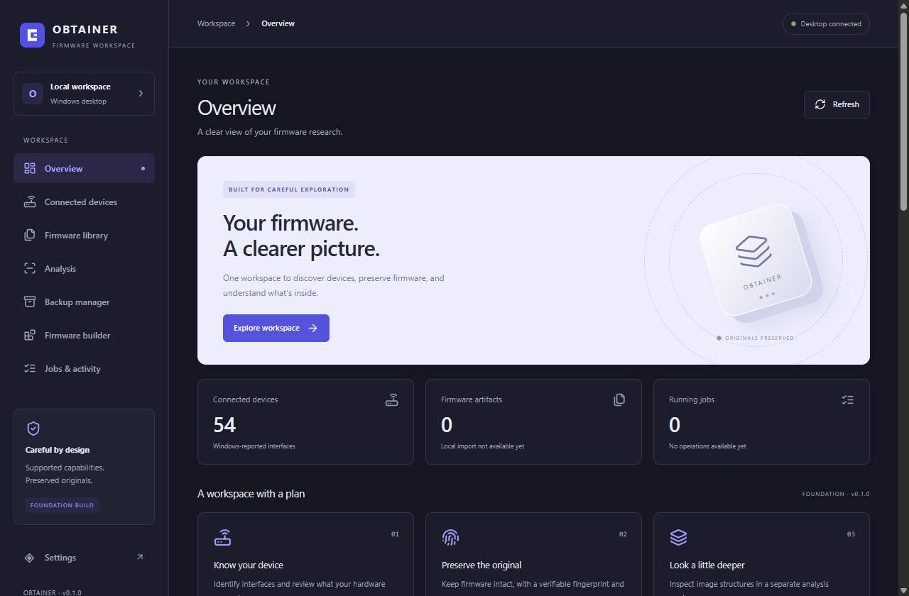

# Phase 0 technical audit — OBTAINER

Audit date: 15 October 2026. Repository root (`R` below): `C:/Users/chuka/OneDrive/Documents/Firm_Find`. Baseline commit: `643ce9f2f12db6533f13b33542511b9eec01ef89`, branch `main`, tracking `origin/main`.

## A. Executive summary

**Phase 0: COMPLETE. Phase 1 readiness: READY.** This decision follows executed checks, native launch evidence, and read-only checks of the existing database. It does not mark Phase 1 or device customization complete.

The existing Tauri 2 / React / TypeScript / Rust / SQLite application is functional in a normal Windows session using a non-administrator token. An existing debug binary and the freshly built optimized release both rendered React, navigated the workspaces, invoked real Rust commands, refreshed Windows inventory, and preserved the existing appearance setting across restart. The release reported 54 inventory records, schema version 1, zero firmware artifacts, and zero running jobs.

Restricted execution reproduces WebView2 HRESULT `0x800700AA` and a disconnected WebDriver session before IPC. Running the same application outside that restriction succeeds. The evidence scopes the failure to execution context; it does not establish a corrupt WebView profile, a universally broken Windows runtime, or a OneDrive fault. No profile reset or runtime reinstall was needed.

The source relocation was already committed before this audit. Recommendation: **KEEP EXISTING STRUCTURE**. No source migration, data relocation, destructive cleanup, physical router access, or product rename occurred in this run.

## B. Completed Phase 0 activities

- Inspected tracked source, generated areas, configuration, scripts, tests, current branch/history, and the three planning documents. The initial worktree was clean; no pre-existing uncommitted edits needed replacement or removal.
- Located actual frontend/native entry points, all four IPC commands, SQLite schema/migration code, native inventory APIs, fixtures, and placeholder screens. Evidence is classified in section D.
- Checked Windows, Git, npm/Node, local Rust/Cargo/target, native compiler/SDK, WebView2, Tauri, drivers, and optional WSL2. Actual versions appear in section E.
- Validated the installed npm workspace and lockfile in dry-run mode. Ran TypeScript, lint, frontend tests/build, Rust formatting/Clippy/tests, and fresh debug and optimized native builds.
- Attempted restricted native launch, captured its error, then verified native debug and final release flows in the normal Windows session. The normal-session token reported `AdministratorToken: false`, session 1.
- Opened the existing SQLite database with `mode=ro` and `query_only=ON`. Integrity and foreign-key checks passed before and after native runs. Existing preferences and schema version remained unchanged.
- Added `--audit` to `scripts/native-smoke.mjs`: it does not invoke `save_settings`, checks existing preferences after restart, and writes fresh screenshots/logs to unique ignored directories. The broader default smoke behavior remains available.
- Corrected obsolete phase numbers in `apps/desktop/src/app/navigation.ts` and inaccurate dashboard status text in `apps/desktop/src/features/Dashboard.tsx`. These are metadata/copy corrections; no future device feature was added.
- Added [development instructions](DEVELOPMENT.md), tightened the Phase 0 completion gate, and updated the status and historical verification documents. The original guideline remains unchanged.

## C. Outstanding Phase 0 activities

No critical Phase 0 gate remains outstanding. Build, native launch, React, real IPC, existing-settings persistence, and database integrity have current evidence. No owner waiver of a verification limitation is needed.

The following were not performed and are not represented as passing: changing the real user's saved preferences through the native UI, physical router/MiFi hot-plug qualification, opening serial devices, authenticating to routers, firmware access, installer execution/upgrade/uninstall, signing, or a remote GitHub Actions run. Native development-mode launch is a Phase 1 closeout check; bundled debug/release launch was verified here. These scope limits do not grant support to future features.

## D. Repository inventory

Current top-level structure:

```text
.github/                     Windows CI definition
.tools/                      ignored local tools, caches, and audit evidence
apps/desktop/                application source, native backend, assets, configuration
docs/                        plans, current audit, setup, reference, historical evidence
node_modules/                ignored installed npm workspace dependencies
scripts/                     root Rust/Tauri wrappers and native smoke runner
target/                      ignored root Cargo debug/release outputs
workers/                     future-worker README only
Cargo.toml, Cargo.lock, rust-toolchain.toml
package.json, package-lock.json, eslint.config.js, .gitignore
README.md, RFS_MASTER_PLAN.md
```

No `AGENTS.md` was found in the repository or inspected ancestor locations. Future target directories shown in the master plan are not evidence that those modules exist.

| Subsystem | Files | Actual status | Evidence | Next action |
|---|---|---|---|---|
| npm/Cargo workspace and wrappers | `package.json`, `package-lock.json`, `Cargo.toml`, `Cargo.lock`, `rust-toolchain.toml`, `scripts/desktop.ps1`, `scripts/rust.ps1` | IMPLEMENTED AND VERIFIED | Workspace dependency listing, root commands, Rust checks, debug/release builds pass. Cargo member is `apps/desktop/src-tauri`; output remains root `target/`. | Keep root entry points. |
| Frontend entry/configuration | `apps/desktop/index.html`, `apps/desktop/src/main.tsx`, `apps/desktop/tsconfig.json`, `apps/desktop/vite.config.ts`, `eslint.config.js`, `apps/desktop/src/styles.css`, `apps/desktop/public/mark.svg` | IMPLEMENTED AND VERIFIED | TypeScript/Vite pass; actual native screenshot renders bundled React. | Reuse. |
| Shell and eight destinations | `apps/desktop/src/app/App.tsx`, `apps/desktop/src/app/navigation.ts` | IMPLEMENTED AND VERIFIED | Native navigation covers Overview, Devices, Library, Analysis, Backups, Builder, Jobs, Settings. Component tests cover navigation/retry/browser preview. | Phase 1 review of remaining loading/error/reconnect behavior. |
| Overview and activity | `apps/desktop/src/features/Dashboard.tsx`, `apps/desktop/src/components/Activity.tsx` | IMPLEMENTED AND VERIFIED | Native `get_snapshot` supplies actual counts and stored audit events; screenshot reviewed. | Keep future-feature copy truthful. |
| Device Explorer and subscription | `apps/desktop/src/features/Devices.tsx`, `apps/desktop/src/lib/useDeviceInventory.ts` | IMPLEMENTED AND VERIFIED | Native reads and refresh pass; component fixtures cover filtering/errors. Runtime watcher registration reports true. | Add revised Phase 2 manual endpoint/diagnostics requirements; qualify physical hot-plug separately. |
| Rust application entry/domain | `apps/desktop/src-tauri/src/main.rs`, `apps/desktop/src-tauri/src/lib.rs`, `apps/desktop/src-tauri/src/domain.rs` | IMPLEMENTED AND VERIFIED | Native setup succeeds normally; domain validation/risk tests pass. | Preserve existing modules. |
| Read/refresh IPC | `apps/desktop/src-tauri/src/commands.rs`, `apps/desktop/src/lib/backend.ts`, `apps/desktop/src/types/contracts.ts` | IMPLEMENTED AND VERIFIED | Real `get_snapshot`, `get_discovery`, `refresh_discovery` pass in native runs; responses have Rust-owned data. | Keep typed boundaries. |
| Native preference write path | `apps/desktop/src/features/Preferences.tsx`, `apps/desktop/src/lib/backend.ts`, `apps/desktop/src-tauri/src/commands.rs` (`save_settings`) | IMPLEMENTED BUT UNVERIFIED | UI save is tested with mocked IPC; temporary-database write/reopen tests pass. This audit deliberately did not write the user's real preference through native IPC. | Use isolated test data for a later full native write test. |
| Existing preference read/persistence | Same preference files; `apps/desktop/src-tauri/src/storage.rs` | IMPLEMENTED AND VERIFIED | Real `get_snapshot`, UI-selected theme, and restart comparison agree. Before/final settings hashes match. | Preserve current stored values. |
| SQLite initialization/migration | `apps/desktop/src-tauri/src/storage.rs`, `apps/desktop/src-tauri/migrations/001_foundation.sql` | IMPLEMENTED AND VERIFIED | `Repository::open`, `settings`, `save_settings`, `snapshot`, startup/inventory recording; 2 storage tests pass. Actual database integrity is `ok`, schema 1. | Add future migrations transactionally; no schema change now. |
| Windows USB/serial/network capture | `apps/desktop/src-tauri/src/discovery/windows.rs` | IMPLEMENTED AND VERIFIED | SetupAPI/Configuration Manager, registry reads, and IP Helper calls are real. Runtime reports USB 1, serial 1, network 54; transport counts overlap. No serial/device handle is opened. | Device-specific identity and hardware qualification remain later work. |
| Correlation and lifecycle reconciliation | `apps/desktop/src-tauri/src/discovery/mod.rs` | IMPLEMENTED AND VERIFIED | `assemble`, `DiscoverySnapshot::reconcile`, `replay_fixture`; fixture tests cover composite identity, reconnect, unrelated devices, cycles, and gateways. | Physical hot-plug remains unverified. |
| Discovery worker/notifications | `apps/desktop/src-tauri/src/discovery/service.rs`, `apps/desktop/src-tauri/src/discovery/windows.rs` | PARTIALLY IMPLEMENTED | `DiscoveryService::start/snapshot/refresh_request/shutdown`, bounded queues/debounce/rescan and event emission exist. Native refresh and notification registration pass; physical arrival/removal delivery was not exercised. | Record physical event/reconnect evidence in Phase 2. |
| Router identity and feature decisions | `apps/desktop/src-tauri/src/discovery/mod.rs`, `apps/desktop/src/types/contracts.ts`, `docs/DEVICE_SUPPORT.md` | PARTIALLY IMPLEMENTED | Heuristics and evidence labels exist; feature states remain UNKNOWN and flashing UNSUPPORTED on every native record. No exact-model profile engine exists. | Phase 3 profiles and seven reasoned decision states. |
| Firmware library/import | `apps/desktop/src/features/Planned.tsx`, navigation; reserved `firmware_artifacts` table | PLACEHOLDER ONLY | No ingestion/hash/import service or IPC command; table and vault contain zero artifacts. | Phase 4. |
| Firmware analysis | `apps/desktop/src/features/Planned.tsx`, `workers/README.md` | PLACEHOLDER ONLY | No parser, extractor, analysis backend, or executable worker. | Later bounded OEM inspection phase. |
| Backups/configuration snapshots | `apps/desktop/src/features/Planned.tsx` | PLACEHOLDER ONLY | No backup/restore/snapshot API or stored configuration snapshots. | Phase 8 transaction/backup work. |
| OpenWrt builder | `apps/desktop/src/features/Planned.tsx`, `workers/README.md` | PLACEHOLDER ONLY | No firmware build worker; Tauri application builds are not router firmware builds. | Phase 15. |
| Generic jobs/history | Jobs view in `apps/desktop/src/app/App.tsx`; activity component; reserved `jobs` table | PARTIALLY IMPLEMENTED | Stored audit events are real; no job coordinator, cancellation, or import/build jobs exist. Running jobs = 0. | Phase 4 durable jobs. |
| Adapters, router simulator, DNS/Wi-Fi/APN/USSD control | No production modules or IPC commands | NOT IMPLEMENTED | Complete source inventory and command registration show no connected implementation. Discovery fixtures are not an interactive router simulator. | Follow phases 3–14 without bypassing their gates. |
| Security baseline | `apps/desktop/src-tauri/tauri.conf.json`, `apps/desktop/src-tauri/capabilities/main.json`, `apps/desktop/src-tauri/build.rs`, `apps/desktop/src-tauri/permissions/autogenerated/{get_snapshot,save_settings,get_discovery,refresh_discovery}.toml`, domain/contracts modules above | PARTIALLY IMPLEMENTED | CSP, allowlisted IPC, typed validation and parameterized SQL exist; tests verify malformed settings and forbidden risk classes. No physical write API exists. | Later security/credential/hardening qualification. |
| Frontend tests/mocks | `apps/desktop/src/test/App.test.tsx`, `apps/desktop/src/test/Devices.test.tsx`, `apps/desktop/src/test/backend.test.ts`, `apps/desktop/src/test/setup.ts` | IMPLEMENTED AND VERIFIED | 3 files, 10 passing tests. Mocked native responses and synthetic devices are confined to tests. Production browser preview refuses native calls. | Keep fixture evidence distinct from native evidence. |
| Rust tests/fixtures | `apps/desktop/src-tauri/src/discovery/tests.rs`, tests in `apps/desktop/src-tauri/src/storage.rs` and `apps/desktop/src-tauri/src/domain.rs`, `apps/desktop/src-tauri/fixtures/discovery-lifecycle.json`, `apps/desktop/src-tauri/examples/discovery-replay.rs` | IMPLEMENTED AND VERIFIED | All 11 Rust tests pass, including actual passive Windows capture. Replay example is a fixture tool, not production inventory. | Add tests when real new behavior arrives. |
| Native runner and CI | `scripts/native-smoke.mjs`, `.github/workflows/windows.yml` | IMPLEMENTED AND VERIFIED | Local audit-mode debug/release native runs pass. CI definition uses root npm/Cargo/build entry points; no remote CI execution was claimed. | Phase 1 development launch and later release qualification. |

## E. Development environment

| Dependency | Installed version | Status | Notes |
|---|---|---|---|
| Windows | NT `10.0.26200.9457`, display version `25H2` | PASS | `cmd ver`; Cargo identifies Windows 11 Core. Registry retains the literal `Windows 10 Home` product label. |
| Git | `2.51.2.windows.1` | PASS | `C:/Program Files/Git/cmd/git.exe`. Global ignore-file access warning does not prevent repository inspection. |
| Node / npm | `22.17.0` / `10.9.2` | PASS | Both resolved under `C:/Program Files/nodejs/`. npm is the project's package manager. |
| Frontend tooling | TypeScript `5.7.3`, Vite `6.4.4`, Vitest `4.1.11` | PASS | Installed workspace listing and executed checks. |
| Rust / Cargo | `1.99.0` / `1.99.0` | PASS | Local ignored toolchain; Rust commit `b940084d7`, Cargo commit `5f94df478`. |
| Rust channel/target | `stable-x86_64-pc-windows-msvc`; installed target `x86_64-pc-windows-msvc` | PASS | `rustup show active-toolchain` and `target list --installed`. `stable` is mutable, so compiler versions are recorded rather than claiming an immutable toolchain pin. |
| Visual Studio Build Tools | 2022, `17.14.41`; installation `17.14.37710.0` | PASS | `vswhere` confirms complete x64 C++ installation; actual native builds pass. |
| MSVC tools | Directory `14.44.35207`; `cl.exe` product version `14.44.35229.0` | PASS | File found under `VC/Tools/MSVC/.../bin/Hostx64/x64/`. |
| Windows SDK | Include tree `10.0.26100.0`; `rc.exe` product version `10.0.26100.7705` | PASS | SDK files and compiler/linker build outcome checked. |
| WebView2 / EdgeDriver | Both `155.0.4283.45` | PASS normally | WebView executable version and driver CLI agree; normal native execution passes. Restricted startup fails separately. |
| Tauri CLI / API / Rust crate | CLI `2.12.2`; API/Rust `2.12.3` | PASS | CLI query, npm listing, Cargo build output/lockfile. |
| Tauri driver | `2.1.0` | PASS | Cargo installed-package metadata. Its CLI does not support `--version`; that failed query is recorded below. |
| SQLite | Existing application schema `1`, WAL mode | PASS | Read-only integrity and foreign-key checks; Rust migration/reopen tests. |
| WSL2 | Default distribution `Ubuntu`, default version `2` | PASS normally | Restricted query returned access denied; normal-session `wsl --status` succeeded. Optional to the desktop app. |
| Python (audit helper only) | `3.13.5` | PASS | Used to inspect SQLite in read-only mode; not a desktop app prerequisite. |
| OneDrive / capacity | No OneDrive process observed in normal session | No demonstrated sync blocker | Inspected source attributes show available files, not offline placeholders. Builds pass at the existing OneDrive path. Free-space snapshots changed from about 1.8 GB to 30.4 GB during the audit; this run performed no cleanup. |

## F. Executed verification commands

All commands used working directory `R`. “Normal session” means outside restricted execution, with a non-administrator token. Rust lint/test/native builds set the process-local `CARGO_INCREMENTAL=0`; no global setting was changed. Raw command strings/output are retained locally in `.tools/phase-0-audit/commands.json`; native run directories preserve separate driver logs/screenshots.

| Command | Working directory | Result | Error or evidence |
|---|---|---|---|
| `git status --short --branch`; `git diff --stat`; `git ls-files --others --exclude-standard` | R | PASS | Initial tree clean on `main...origin/main`; existing history retained. |
| `git log -5 --format='%h %ad %s' --date=iso-strict`; `git rev-parse HEAD`; `git log --follow ... -- apps/desktop/src/main.tsx` | R | PASS | Baseline HEAD and prior relocation commit identified. |
| `rg --files --hidden` with `.git`, dependencies, tools, target, dist, and generated schema directories excluded; `Get-Content -Encoding UTF8` on inventoried source/config/docs | R | PASS | Actual modules/functions and absent implementations recorded in section D. |
| `cmd /c ver`; `Get-ItemProperty 'HKLM:\SOFTWARE\Microsoft\Windows NT\CurrentVersion'` | R | PASS | Build/display version in section E. |
| `git --version`; `node --version`; `npm.cmd --version`; `Get-Command git,node,npm.cmd` | R | PASS | Actual versions and paths recorded. |
| Local `.tools/cargo/bin/rustc.exe -Vv`, `cargo.exe -Vv`, `rustup.exe show active-toolchain`, `rustup.exe target list --installed` with local homes set | R | PASS | Versions, host and installed target recorded. |
| `vswhere.exe -products '*' -requires Microsoft.VisualStudio.Component.VC.Tools.x86.x64 -format json`; SDK/compiler/WebView file-version probes | R | PASS | Native installation present and versions recorded. Full probes retained in command evidence. |
| `node node_modules/@tauri-apps/cli/tauri.js --version` | R | PASS | `tauri-cli 2.12.2`. |
| `.tools/webdriver/msedgedriver.exe --version` | R | PASS | `155.0.4283.45`. |
| `.tools/cargo/bin/tauri-driver.exe --version` | R | FAIL | `unused arguments left: ["--version"]`; unsupported diagnostic flag, not a failed app test. |
| `powershell -NoProfile -ExecutionPolicy Bypass -File scripts/rust.ps1 install --list` | R | PASS | Corrected version query reports `tauri-driver v2.1.0`. No installation performed. |
| `wsl.exe --status` in restricted execution | R | FAIL | `Wsl/EnumerateDistros/Service/E_ACCESSDENIED`. |
| `wsl.exe --status` in normal session (captured/decoded through Python subprocess) | R | PASS | Ubuntu, default version 2. |
| Normal-session `Get-Process OneDrive` and Windows-principal administrator-role query | R | PASS | No OneDrive process; administrator token false, session 1. |
| `npm.cmd ci --dry-run --ignore-scripts --offline --cache .tools/npm-cache` | R | PASS | Lockfile accepted. Reported optional-package additions are simulated; no real reinstall claimed. |
| `npm.cmd ls --workspace=@obtainer/desktop --depth=0` | R | PASS | Workspace link and all direct installed dependencies resolve. |
| `node node_modules/typescript/bin/tsc --project apps/desktop/tsconfig.json --noEmit` | R | PASS | No TypeScript diagnostics. |
| `npm.cmd run lint` | R | PASS | Initial and final code checks; zero warnings. |
| `npm.cmd test` | R | PASS | Initial and final code checks; 3 files, 10 tests. Native responses here are mocked. |
| `npm.cmd run build` | R | PASS | TypeScript and Vite production build, 1,601 modules. Repeated by native build hooks after the copy/tag correction. |
| `powershell -NoProfile -ExecutionPolicy Bypass -File scripts/rust.ps1 fmt --all --check` | R | PASS | Formatting clean. |
| `powershell -NoProfile -ExecutionPolicy Bypass -File scripts/rust.ps1 clippy --workspace --all-targets --locked --offline -- -D warnings` | R | PASS | No Clippy warnings. |
| `powershell -NoProfile -ExecutionPolicy Bypass -File scripts/rust.ps1 test --workspace --locked --offline` | R | PASS | 11 Rust tests, including real Windows capture and temporary SQLite persistence. |
| `npm.cmd run tauri -- build --debug --no-bundle --ci -- --locked --offline` | R | PASS | Fresh `target/debug/obtainer.exe`. |
| `npm.cmd run tauri -- build --no-bundle --ci -- --locked --offline` | R | PASS | Fresh optimized `target/release/obtainer.exe`; no installers generated by this command. |
| `npm.cmd run test:native -- target/debug/obtainer.exe --audit` in restricted execution | R | FAIL | WebDriver loses DevTools/session connection before `Desktop connected`. |
| Direct `Start-Process` of `target/debug/obtainer.exe` with separate stdout/stderr, in restricted execution | R | FAIL | Process exits within 10 seconds; stderr records WebView2 `0x800700AA`, “The requested resource is in use.” The probe shell itself completed successfully. |
| `npm.cmd run test:native -- target/debug/obtainer.exe --audit` in normal session | R | PASS | Real rendering/navigation/IPC/discovery/restart checks; no saved-preference write. |
| `npm.cmd run test:native -- target/release/obtainer.exe --audit` in normal session | R | PASS | Final release: real rendering/navigation/IPC, 54 records, refresh and existing-settings persistence. |
| `py .tools/phase-0-audit/probe-data.py` with before/after/final evidence destinations | R | PASS | Read-only SQLite integrity `ok`, foreign-key check empty, schema 1; preferences hash unchanged. |
| Markdown-link/phase-index checks and `git diff --check` | R | PASS | Current links/phase numbering validated; no whitespace errors. |
| Remote CI run; new installer execution/signing | R | NOT APPLICABLE | Not executed in this baseline audit. Historical installers are not fresh release qualification. |

Current executable evidence:

| Artifact | Bytes | SHA-256 |
|---|---:|---|
| `target/debug/obtainer.exe` | 16,231,936 | `23EAA3E145845F36D35EE26711CD7887BF9866AC5CD084BF3B4F85E6EE990DCB` |
| `target/release/obtainer.exe` | 11,109,376 | `716792F0B6CFDE833A2EFAAAB0BCDAB8152E25312285ADC3F76B437F491288F4` |

## G. Existing functionality

`main.rs` calls `obtainer_lib::run`. Native setup creates the existing application directories, opens SQLite, records startup, starts the passive discovery service, registers managed state and four commands, then runs the Tauri event loop. React reads Rust-owned state through `get_snapshot`; backend responses and outgoing settings are validated at the TypeScript boundary.

Overview and Jobs/Activity display real counts/audit records. Device Explorer reads real Windows inventory, filters it, shows evidence/capability uncertainty, and requests refresh. Settings reads the saved appearance; temporary-database tests verify write/reopen behavior. Library, Analysis, Backups, and Builder navigate to explicitly planned screens, not working firmware operations.

Discovery uses SetupAPI, Configuration Manager, registry COM-port/adapter metadata and `GetAdaptersAddresses`; it has native PnP/IP-interface notifications with periodic fallback. There is no PowerShell inventory fallback and no production mock provider. Fixture replay and frontend mock devices belong to tests/example tooling. Runtime transport totals overlap: one correlated record can include USB, serial, and network functions. The 54 records are Windows-visible interfaces/devices, not 54 verified routers. Chipset, firmware version, ownership, feature write support, and physical modem behavior remain unproved.

Naming is consistent with the owner's earlier selection; no rename is needed:

| Metadata | Current value |
|---|---|
| Product / window title | `OBTAINER` |
| Executable / Rust package | `obtainer.exe` / `obtainer` |
| Rust library | `obtainer_lib` |
| Application identifier | `com.obtainer.desktop` |
| Root npm package / desktop workspace | `obtainer-workspace` / `@obtainer/desktop` |
| RFS terminology | Reference architecture/guideline name; retained master-plan filename, not a second executable brand. |

## H. Desktop launch results

1. The initial restricted audit run of the existing debug executable failed before IPC. A direct launch probe captured its WebView2 panic; this was actual native execution, not a frontend web-server check.
2. The same debug executable passed the native audit in the normal Windows session. It rendered the interface, visited all eight destinations, read SQLite over IPC, invoked discovery/refresh, closed, reopened, and retained the existing theme.
3. After the bounded metadata corrections, fresh debug and optimized release builds passed. The final release passed the same normal-session audit. Discovery was `ready`, `watching: true`, warnings empty, USB 1 / serial 1 / network 54, with every feature UNKNOWN and flashing UNSUPPORTED.
4. Both native snapshots and UI preference reads matched across restart. No `save_settings` command is issued by audit mode. The final native screenshot was visually inspected and preserved separately from the older screenshot.



For manual reproduction, launch `target/release/obtainer.exe` in the normal desktop session; verify “Desktop connected,” visit each navigation item, refresh Devices, record the selected Settings appearance, close OBTAINER, relaunch, and compare it without changing it. If a later environment cannot perform these checks, label them UNVERIFIED rather than substituting a successful web preview or compile.

## I. Persistent data locations

| Data | Actual path | State and protection |
|---|---|---|
| SQLite database/settings | `C:/Users/chuka/AppData/Local/OBTAINER/obtainer.db` | Main file 4,096 bytes; WAL mode, schema 1. Settings row `preferences`, theme `system`. Opened read-only by the audit probe. |
| SQLite companion files | Same directory, `obtainer.db-wal` and `obtainer.db-shm` | WAL grew from 177,192 to 350,232 bytes during normal application activity. No checkpoint, deletion, or relocation was requested by the audit. Copying the main file alone would omit uncheckpointed data. |
| Application logs | `C:/Users/chuka/AppData/Local/OBTAINER/logs/` | Two daily JSON log files after native runs. Existing logs preserved. |
| Firmware vault | `C:/Users/chuka/AppData/Local/OBTAINER/vault/` | Exists, zero files; firmware-artifact table also zero. |
| Workspaces/reports | `C:/Users/chuka/AppData/Local/OBTAINER/workspaces/`, `reports/` | Both exist, zero files. No implemented configuration-snapshot storage. |
| WebView2 profile | `C:/Users/chuka/AppData/Local/com.obtainer.desktop/EBWebView/` | Existing separate browser profile; never reset or moved. No roaming profile directory was found. |
| Device profiles/imports/snapshots | No production profile store, imported firmware, or configuration-snapshot files found | Future features, not inferred from empty reserved tables/directories. |
| New audit evidence | Repository `.tools/phase-0-audit/` and unique `.tools/native-audit/<timestamp>/` directories | Ignored helpers, command evidence, read-only database reports, driver logs/screenshots. New shared screenshot is in `docs/images/`. |

Before native runs: settings 1, audit events 13, devices 0, artifacts 0, jobs 0. Final: settings 1, audit events 21, devices 54, artifacts 0, jobs 0. The additional audit/inventory records are normal existing application behavior. The audit did not preserve a byte-identical WAL because the app was intentionally launched; it preserved existing user preferences and schema and verified database integrity.

Before/final preference fingerprint: `70ca50b9ab62d27cbc6340ed90d7ebab7596b61ac8875a63e86219af831f4d97`. Both read-only probes left database/WAL bytes unchanged during the probes themselves. `PRAGMA integrity_check` returned `ok`; `foreign_key_check` returned no rows.

Current migration strategy is schema version 1, transactional initialization from `001_foundation.sql`, and rejection of newer schemas. The audit added no migration. Application data is outside the source checkout, so the prior source move did not change its configured location. No OneDrive-specific file-access failure was reproduced.

## J. Migration recommendation

**KEEP EXISTING STRUCTURE.** Commit `2c07c61` already contains the move into `apps/desktop/`; the baseline is not the former root `src/` layout. Root npm/Cargo commands, Tauri `frontendDist: ../dist`, wrappers, fixtures, and build output paths now work in the current structure. No new technical blocker justifies another migration.

Keep the root lockfiles, single Cargo member, current application identifier, and existing data paths. There is no source/data migration or migration rollback to perform in this audit. Future feature modules should be added as their phases require, preserving the existing implementation and user changes.

## K. Phase 0 blockers

No unresolved critical Phase 0 blocker remains. Restricted WebView2 and WSL access failures are recorded with successful normal-session counterchecks. Use a normal Windows session for graphical acceptance. The unsupported Tauri-driver `--version` query was replaced with installed-package metadata.

Remaining limits are explicit: no live preference overwrite, physical router qualification, future-feature implementation, remote CI run, fresh installer execution, or signed release claim. Dependency lockfiles and observed tool versions establish the current baseline; mutable Rust `stable` is recorded as a reproducibility caveat, not a byte-identical-build guarantee.

## L. Phase 1 readiness

**READY.** The stricter Phase 0 gate is satisfied: inspected source and Git state, actual environment versions, passing checks/builds, native normal-user launch/IPC/navigation, settings across restart, and real-data integrity evidence are recorded. The [phase tracker](PHASE_STATUS.md) contains the completed acceptance checklist.

This run stops at the Phase 0 boundary. The smallest next task is Phase 1 development-mode launch verification and a bounded review of shell loading/error/reconnect gaps. Device adapters, simulator, profiles and customization features retain their later phase gates.
