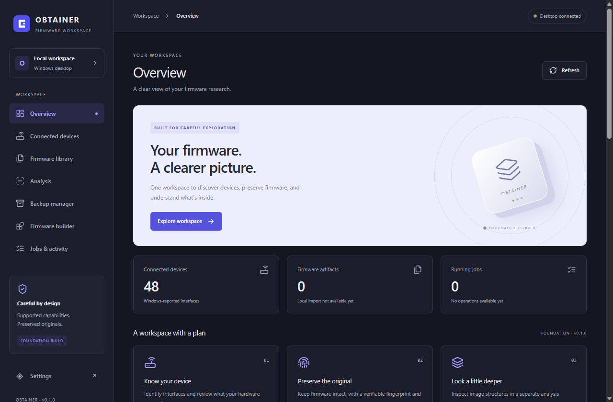

# Phase 1 — Windows desktop foundation verification

Verified: **16 October 2026**, Africa/Lagos. Repository: `C:/Users/chuka/OneDrive/Documents/Firm_Find`. Initial clean Git baseline: `4c3c48853d76190a248976859065f58c76b8931b` on `main`.

**Phase 1: COMPLETE.** Actual development and production native launches, navigation, IPC, settings writes/persistence, startup recovery, regression checks and data protection satisfy the foundation gate. Phase 0 was accepted and its audit/roadmap were retained. No Phase 2 or customization work began.

Exact commands, exit codes, failures and captured output: [execution transcript](evidence/phase-1-2026-10-16.txt). Development setup and acceptance commands: [development guide](DEVELOPMENT.md).

## Changes and corrected defects

The functional shell, Windows discovery, four Tauri commands, SQLite storage, application identity and existing workspace remain in place.

| Source | Problem and resulting behavior |
|---|---|
| `apps/desktop/src/app/App.tsx`, `App.refresh` and effects | Cached data previously kept the badge “Desktop connected” after a failed refresh. The badge now distinguishes connecting, refreshing, failed and connected states, retains cached information on failure, and supports real retry. A request counter ignores stale replies and invalidates requests on unmount. |
| Same file, initial inventory revision effect | The first completed discovery scan was skipped, so a workspace snapshot read before enumeration could retain stale counts. Every new discovery revision, including the first, now refreshes workspace metadata. |
| Same file, `App.persist` and notices | A successful settings write followed by a failed metadata read was reported as an unsuccessful save. Confirmed writes now remain successful, while the separate workspace-read error remains visible. Failed writes retain the draft and can be retried with Save preferences; unrelated Refresh does not masquerade as retrying a write. |
| `apps/desktop/src/features/Preferences.tsx`, `Preferences` | Refreshing unrelated snapshot metadata discarded an unsaved theme choice. Synchronization now depends on the saved theme value rather than the entire snapshot object. |
| `apps/desktop/src/lib/useDeviceInventory.ts`, `useDeviceInventory` | A temporary read error could remain after a successful notification; manual refresh could erase a failed-subscription warning. Read failures clear on successful reads; subscription warnings remain independently visible. Existing monotonic revision handling and subscription cleanup are retained and regression-tested. |
| `apps/desktop/src/features/Devices.tsx`, `Devices` | Failure before the first inventory result left Refresh disabled indefinitely. Initial failures now show “Inventory unavailable” with an enabled recovery action, distinct from pending/empty/success states. |
| `apps/desktop/src/components/ViewBoundary.tsx` and its use in `App` | Feature-render failures now have a contained retry state; the sidebar remains available and changing destination resets the boundary. It does not claim to recover a native-process crash. |
| `scripts/verify-foundation.mjs`; additive `package.json` script `test:foundation` | New native acceptance runner uses the real Tauri dev command and native WebView2 CDP endpoint, verifies HMR/process identity, lifecycle/IPC/settings/console health, and preserves separate evidence. No new package, Tauri permission or production mock provider was introduced. |

The native runner temporarily instruments the frontend module only for explicitly labelled read-failure/delay tests, and changes a sentence to demonstrate HMR. It restores the exact source read at test start, refuses to overwrite conflicting concurrent edits, and verifies real IPC for all positive paths. Tauri's protected `invoke` implementation and the production backend module remain unchanged.

## Requirement results

| Requested requirement | Classification | Evidence |
|---|---|---|
| Read Phase 0 audit/status/roadmap | VERIFIED | Read before implementation; Phase 0 audit and roadmap match the initial baseline. |
| Preserve structure, user work, data and commands | VERIFIED | Initial worktree clean; no source move/reset/cleanup or data/schema/identity change. Existing scripts remain; `test:foundation` is additive. |
| Existing development command launches native Windows app | VERIFIED | `npm.cmd run tauri -- dev -- --locked --offline` runs the existing root wrapper, Vite and Cargo; real native window/React/IPC verified. Normal completed dev launches exit 0. |
| React connects reliably to Rust | VERIFIED | Initial render and explicit reload both connect; actual `get_snapshot`, `get_discovery` and `refresh_discovery` succeed. Final settings roundtrip also verifies actual native UI `save_settings`. |
| All eight destinations | VERIFIED | Overview, Connected devices, Firmware library, Analysis, Backup manager, Firmware builder, Jobs & activity, Settings checked in development, recovery and production. Planned screens remain planned. |
| Loading, empty, success and error states | VERIFIED | 24 frontend tests; native pending/error/retry tests with labelled fault injection and real IPC recovery. Empty and initial-read failures are component fixtures, not fabricated hardware results. |
| SQLite initialization and restarts | VERIFIED | Rust temporary-DB initialization/reopen tests pass; actual existing schema-1 DB accessible after normal and interrupted launches, integrity `ok`. |
| Settings persist between development and production | VERIFIED | Changed appearance saved through production UI; development reads the changed value from the same directory, restores original through UI; production restart reads original. |
| Discovery/refresh without duplicate records | VERIFIED | Three native refreshes in each final dev/recovery/production session; unique stable IDs asserted; status ready, 48 records, no warnings. Discovery backend retained. |
| Generic Windows records do not become verified routers | VERIFIED | UI identifies Windows-observed interfaces, native feature states remain UNKNOWN, flashing UNSUPPORTED; Rust gateway/correlation tests pass. 48 records is not a verified-router count. |
| Frontend/backend warnings and development-console errors | VERIFIED | Final console capture has zero warnings/errors/unhandled exceptions; launch logs reviewed. Expected Vite/React development information remains informational. |
| Hot reload without duplicate app/server processes | VERIFIED | Temporary React text change renders in native window, restoration renders too; native app PID/window and Vite PID unchanged. One app/one Vite process in dev, one app/no Vite in production. |
| Startup/shutdown/reopen/interruption recovery | VERIFIED | Normal close releases app/Vite/listeners. Test-owned launch interrupted after Vite starts, before native page appears; next dev launch and production launch pass. |
| TypeScript/lint/tests/format/Clippy/build commands | VERIFIED | All final required checks exit 0; frontend 24 tests, Rust 11 tests, fresh frontend and Tauri optimized build. |
| Relevant regressions and reporting | VERIFIED | 14 frontend tests added over the accepted 10-test baseline; current report, transcript, screenshots and phase tracker updated. |

Physical router hot-plug qualification, device authentication and customization remain later work. This verification sent no router commands or network probes and opened no serial device.

## Actual native sessions and evidence

Initial development command was launched directly through the existing root script. Native app PID `21196` rendered against `http://127.0.0.1:1420/`, navigated and invoked Rust. A later attached audit passed loading/error/HMR checks and closed it normally; the direct development command exited 0.

The final complete lifecycle runner, `npm.cmd run test:foundation`, exits **0**. Evidence directory: `.tools/foundation/2026-10-16T11-21-55.402Z/`.

| Session | Native URL | App PID | Result |
|---|---|---:|---|
| Development reopen | `http://127.0.0.1:1420/` | 15384 | Eight destinations, real IPC/SQLite, three discovery refreshes, labelled failure/delay recovery, HMR and cleanup pass. |
| Controlled interrupted launch | Vite listener started; no native page yet | Test-owned process tree | Intentionally terminated, exit 1. No leftover app/Vite/listener; interruption is expected test behavior. |
| Development recovery | `http://127.0.0.1:1420/` | 22864 | Initial render, reload, eight destinations, real IPC/SQLite, three refreshes and clean close pass. |
| Production | `http://tauri.localhost/` | 3268 | Fresh optimized executable; same database/settings; navigation/IPC/discovery and clean close pass. |

`results.json` records completed steps and child exit codes; `launch-0-dev.txt` through `launch-3-release.txt` contain actual command output; `console.json` contains captured native console events and `console-issues.json` is `[]`. The three normally completed children exit 0; the intentionally interrupted child exits 1. The test runner exits 0.

### Settings write across both modes

`npm.cmd run test:foundation -- --settings-roundtrip` exits **0**. Evidence directory: `.tools/foundation/2026-10-16T11-29-56.552Z/`.

1. Production UI changes the existing `system` appearance to `dark` and saves it through real React → Rust → SQLite.
2. Production closes; development starts and both IPC and selected UI appearance report `dark` from the same directory.
3. Development UI restores `system` and saves it.
4. Development closes; production starts and confirms the complete settings object equals the original.
5. All owned windows/servers close; console health passes.

This is a real changed-value persistence test. Earlier same-value native writes also passed; they are not substituted for this roundtrip.

### Visual review

The development and production screenshots were opened and visually inspected. Both show the native React shell, “Desktop connected,” 48 Windows inventory records, and zero artifacts/jobs. Loading/error screenshots show the expected states with cached records retained.




Additional evidence: [loading](images/phase-1-loading-2026-10-16.png), [labelled injected error](images/phase-1-error-2026-10-16.png), [hot-reloaded text](images/phase-1-hmr-2026-10-16.png). Native window handles and process paths were checked separately; screenshots are not from a browser preview.

## Regression coverage and commands

Frontend: **5 files, 24 tests passed**. Existing tests retained; added coverage for pending connection, failed refresh with cached data, initial inventory completion/stale workspace replies, unsaved theme drafts, confirmed save followed by failed read, failed-write retry, notification recovery/subscription warning, out-of-order revisions, subscription cleanup/late resolution, initial inventory failure/loading/empty states, and render-boundary retry/navigation.

Rust: **11 tests passed**, including actual passive Windows capture and temporary-database migration/settings persistence/newer-schema rejection. Rust source and discovery implementation were not replaced or changed.

Principal final commands (repository root):

```powershell
node node_modules/typescript/bin/tsc --project apps/desktop/tsconfig.json --noEmit
npm.cmd run lint
$env:DEBUG_PRINT_LIMIT='1200'; npm.cmd test
powershell -NoProfile -ExecutionPolicy Bypass -File scripts/rust.ps1 fmt --all --check
$env:CARGO_INCREMENTAL='0'; powershell -NoProfile -ExecutionPolicy Bypass -File scripts/rust.ps1 clippy --workspace --all-targets --locked --offline -- -D warnings
$env:CARGO_INCREMENTAL='0'; powershell -NoProfile -ExecutionPolicy Bypass -File scripts/rust.ps1 test --workspace --locked --offline
npm.cmd run build
$env:CARGO_INCREMENTAL='0'; npm.cmd run tauri -- build --no-bundle --ci -- --locked --offline
npm.cmd run tauri -- dev -- --locked --offline
npm.cmd run test:foundation
npm.cmd run test:foundation -- --settings-roundtrip
```

All final checks above pass. `DEBUG_PRINT_LIMIT` limits failing DOM output only; `CARGO_INCREMENTAL` is process-local. Existing cached dependencies support locked/offline checks; no new install was required. The Tauri build ran its configured frontend build and native optimized compilation. Installer packaging, signing and clean-machine installation were not part of this phase.

Fresh release: `target/release/obtainer.exe`, **11,109,888 bytes**, SHA-256 `C487B49E2A1010983162FF937001E4A9E69668B9270B53CB4FB3DCE5519C0096`.

The [transcript](evidence/phase-1-2026-10-16.txt) contains exact commands, exit codes and output for every command ID below, including failed attempts. Ignored orchestration records are also retained under `.tools/phase-1/`.

| Command ID | Exit | Observed result |
|---|---:|---|
| `dev-help` | 0 | Local CLI confirms forwarding runner arguments after --. |
| `data-before` | 0 | Read-only original data fingerprint; integrity ok, schema 1, system theme. |
| `initial-dev-launch` | 0 | Actual root Tauri development command; native compiled/rendered; closed normally with exit 0. |
| `initial-dev-target` | 1 | Premature CDP probe before native compilation finished; endpoint unavailable. |
| `regressions-before-fixes` | 1 | Red run: 8 failures / 19 tests; seven demonstrated state defects and one StrictMode test assumption. Tool output was truncated. |
| `compiled-dev-target` | 0 | Real native WebView target at the Vite development URL. |
| `typecheck` | 1 | New test mock returned an overly broad Vitest Mock type; corrected to a callable () => void. |
| `lint` | 0 | Initial application-fix ESLint pass. |
| `frontend-tests` | 1 | 20/21 pass; existing one-shot failure fixture raced the newly working first-inventory recovery; fixture changed to fail until explicit retry. |
| `typecheck-retry` | 0 | Test mock typing corrected; exit 0. |
| `frontend-tests-retry` | 0 | 21 frontend tests pass after state fixes. |
| `lint-runner` | 1 | New acceptance runner threw from finally; cleanup error handling corrected. |
| `lint-acceptance-runner` | 0 | ESLint passes after cleanup fix. |
| `native-dev-initial` | 1 | First harness injection could not overwrite Tauri's immutable invoke property. Actual rendering/navigation/IPC/discovery passed, but the requested injected error never occurred. |
| `native-dev-initial-retry` | 0 | Native dev error/loading/HMR/cleanup acceptance passes with temporary, explicitly labelled frontend instrumentation; source restored. |
| `rust-format` | 0 | Rust formatting passes. |
| `rust-clippy` | 0 | Workspace/all targets, warnings denied, locked/offline: pass. |
| `frontend-tests-latest` | 0 | 23 frontend tests pass, including initial discovery-failure recovery and loading/empty distinction. |
| `typecheck-complete` | 0 | Dedicated project TypeScript noEmit check passes. |
| `lint-complete` | 0 | ESLint passes. |
| `rust-tests` | 0 | 11 Rust tests pass; includes native passive Windows capture and temporary DB initialization/settings/reopen. |
| `frontend-build` | 0 | Production build passes; 1,602 modules. |
| `frontend-tests-final` | 0 | Final 5 files / 24 frontend tests pass. |
| `tauri-release-build` | 0 | Fresh optimized Tauri executable built; configured frontend build also passes; no installer bundling. |
| `native-foundation-full` | 1 | First full lifecycle attempt failed the post-interruption connection wait after an immediate forced page reload. Initial render of that recovery attempt was not captured; failure retained. |
| `post-interrupt-data` | 0 | Existing SQLite remains intact after interrupted-launch attempt. |
| `native-foundation-readiness` | 0 | Final full lifecycle passes: wait for first React/IPC bootstrap before reload, dev reopen/HMR, controlled startup interruption, recovery, production, console and process cleanup. |
| `data-after` | 0 | Post-lifecycle read-only DB integrity/settings check passes. |
| `lint-final-runtime-runner` | 0 | Final readiness/diagnostic runner passes ESLint. |
| `protected-files` | 0 | Rust/discovery/storage/config/locks/original wrappers/native smoke/Phase 0 report/roadmap unchanged. |
| `native-settings-roundtrip` | 0 | Actual native UI changed appearance in production; dev read it from the same DB and restored original; production restart confirmed original; console and cleanup pass. |
| `data-final` | 0 | Final integrity ok, schema 1, original system theme/hash restored; 52 audit events and 48 cached device records. |
| `lint-settings-runner` | 0 | Final settings acceptance runner passes root ESLint. |
| `frontend-tests-boundary-final` | 0 | Final 24 frontend tests pass, including navigation away from a failed view. |
| `validate-evidence` | 0 | 19 local links, 15 verified requirements, all 20 phase rows, absent temporary hooks, preserved settings/integrity, zero native console issues and matching release hash. |
| `final-whitespace` | 0 | git diff --check passes; normal LF/CRLF notices only. |
| `final-protected` | 0 | Original Rust/discovery/storage/config/locks/wrappers/Phase 0 report and roadmap remain unchanged. |
| `final-status` | 0 | Only intended Phase 1 code/tests/docs/new evidence; no source migration, reset or commit. |

## Failed attempts and their resolution

- The first regression run had 8 failures of 19 tests: seven demonstrated state-handling gaps plus a StrictMode test that incorrectly assumed exactly two subscriptions. The test now checks actual cleanup regardless of replay count, with a separate late-registration cleanup case.
- A new Vitest mock needed an explicit callable type for TypeScript. A new runner cleanup originally threw inside `finally`; ESLint rejected it. Both were corrected and final checks pass.
- An existing one-shot backend-error test raced newly implemented automatic first-inventory recovery. Its fixture now remains failed until the test explicitly retries, preserving its original behavioral requirement.
- Initial native fault injection attempted to replace Tauri's immutable `invoke` property. The error-state assertion correctly failed because no fault was injected. The runner now instruments the development frontend temporarily and restores it; real native IPC remains intact.
- One complete lifecycle attempt failed the connection wait after forcing a page reload immediately on discovering a new WebView target. The initial document/IPC bootstrap was not captured for that attempt, so its precise cause was not conclusively observed. The runner now first requires a real React/IPC connection, then verifies an explicit reload, and saves screenshots/DOM if connection fails. The subsequent full lifecycle passes, including the same controlled interruption and recovery. No application runtime workaround or profile reset was made.
- The early CDP endpoint probe ran before the native build finished and returned `fetch failed`. A later probe and native session succeeded.
- Initial Tauri output warned that it was waiting for Vite; Vite became ready and launch completed. Final captured renderer warnings/errors/exceptions are zero. The global Git ignore-file permission warning remains unrelated to app behavior.

Failures remain visible in the transcript; successful counterchecks, not erased failures, establish the final result.

## Data and repository preservation

Both modes use **`C:/Users/chuka/AppData/Local/OBTAINER/obtainer.db`** and the existing `logs/`, `vault/`, `workspaces/` and `reports/`. The separate WebView2 profile remains under `C:/Users/chuka/AppData/Local/com.obtainer.desktop/EBWebView/`. No directory, application identifier or schema was switched.

Read-only probes: `.tools/phase-0-audit/phase-1-before.json` and `phase-1-final.json`. Both use `mode=ro` and `query_only=ON`, leave DB/WAL bytes unchanged during the probes themselves, return integrity `ok`, no foreign-key violations, schema 1. The interrupted-launch probe also passes.

| Stored state | Before | Final |
|---|---:|---:|
| Settings rows | 1 | 1 |
| Audit events | 26 | 52 |
| Cached devices | 48 | 48 |
| Firmware artifacts | 0 | 0 |
| Jobs | 0 | 0 |

Final theme is the original `system`. Before/final preference SHA-256: `70ca50b9ab62d27cbc6340ed90d7ebab7596b61ac8875a63e86219af831f4d97`. The theme changed temporarily for the explicit roundtrip and was restored; it was not unchanged throughout the test.

Normal startup, inventory and settings-save audit records explain the expected database/WAL changes. WAL grew from 449,112 to 943,512 bytes; the main file remains 4,096 bytes. Firmware vault, workspaces and reports remain empty; three existing daily logs remain present.

Protected-file comparison exits 0 for the Rust tree, discovery/storage/schema/Tauri configuration, npm/Cargo lockfiles, original wrappers/native smoke, accepted Phase 0 audit and roadmap/master guideline. Temporary backend instrumentation was restored. No reset, commit, push, source migration, profile deletion or destructive cleanup occurred.

## Completion gate and remaining limits

**Phase 1 COMPLETE.** Development and production launch natively, initial render/reload connect to Rust, all destinations navigate, real UI settings survive cross-mode restarts and restore correctly, regression checks/builds pass, console capture is clean, and controlled startup interruption/recovery succeeds. No unresolved critical foundation blocker remains.

Coverage is local to this Windows host. Physical router qualification, authenticated adapters, DNS/Wi-Fi/APN/USSD, firmware import/modification/build/flash, installer/release qualification and long-duration stress testing are not implemented or claimed. Expected platform/test-environment limits and the earlier failed recovery-check attempt are classified above.

Next phase is Phase 2 discovery/candidate-identity completion when requested. This run stops at Phase 1.
