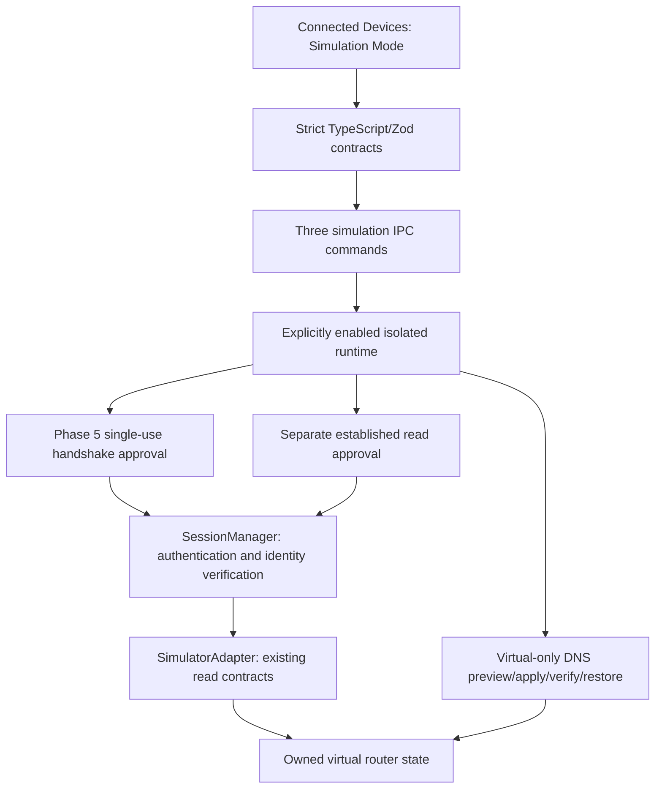

# Simulator architecture

The Phase 6 simulator is an in-memory router and modem, not a network server or a physical device adapter. `simulator/runtime.rs` owns its lifecycle; `model.rs` owns authoritative configuration, services, virtual time, faults, snapshots and scripted USSD. React owns only editable drafts and displays validated backend results.

There is no edge from virtual mutations to a physical adapter, OS network API, shell, modem command or firmware operation. The physical `AdapterOperation::is_physical_write` and backend deny policy remain restrictive.

## Activation and ownership

`npm.cmd run dev:simulator` creates a marked native-test run and launches the dedicated executable with `--simulator`. The ordinary executable rejects that flag before opening normal data. The dedicated executable requires its validated run ID, fixed known-folder root, ownership lock, separate WebView profile and native-test configuration. Without the explicit flag the simulator service remains disabled, including in other native-test sessions. The user then starts the virtual runtime with **Start simulation**; missing real hardware never triggers it.

Simulation commands have a separate Tauri capability selected only by the native-test configuration. The normal capability list and physical command permissions remain unchanged. The snapshot's existing `simulatedAdapters:false` describes the physical discovery/adapter registry; the additional `simulationAvailable:true` marks the explicitly enabled, separate laboratory environment. `simulation_status` reports its actual active state and backend-owned simulated device.

Each runtime owns a private `Authority`: endpoint, peer pin, enabled state and generation. Its fields have no serde representation or frontend constructor. A simulator registry requires this authority, accepts only simulator implementations/transports, and cannot register a physical connector. Normal registries reject simulator implementations/transports and continue rejecting test-only mocks. The Phase 5 mock remains `cfg(test)` only.

The stable fixture ID is `sim-router-001`; its endpoint includes the isolated run/runtime identity. Every request echoes that backend endpoint, ID, generation and configuration revision. The backend verifies them against its current concrete runtime. A physical SHA-256 discovery ID, HTTP address, caller-supplied `simulated:true`, arbitrary operation, or old runtime endpoint cannot create simulation authority.

## Authentication and profiles

The internal adapter projection has transport `simulation`, empty Windows interfaces and empty network adapters. It never enters SetupAPI/IP Helper inventory, the discovery service, a physical support report or SQLite. The existing linked/nonvirtual Windows interface requirement is retained for physical bootstrap; only the private simulator authority permits the separate virtual transport.

The simulator uses the existing `HandshakeApproval`, `SessionManager::connect_initial`, `Secret`, `AuthenticationLifecycle`, `EndpointTrust`, identity validation, profile engine, established `AuthorizationGrant`, `confirm_session_reads`, `OperationControl` and RAII resource cleanup. Approval permits only one bounded handshake. Authentication checks the virtual peer before inspecting the synthetic credential. Current identity is read from the adapter and matched before an established session can be published. Feature reads need a separate grant.

`tests/fixtures/simulator/virtual-router.json` is an explicit fictional schema-1 profile. `SIM-0.1` uses opaque exact firmware matching. The profile has local/unverified provenance and a local reference to this specification. It is authoritative only inside the private runtime's memory registry; normal profile loading does not grant it authority. The matching input initially contains no authenticated evidence. Handshake evidence is generated only after successful virtual authentication/identity reads and stays session-local. No profile/evidence row is installed in the application repository.

## State, mutations and recovery

Configuration revision and session generation are separate. DNS/Wi-Fi/APN changes advance configuration revision; reset/disconnection and identity/endpoint fault transitions invalidate generation, authorization and cached feature/preview/result state. Scenario selection reserves the operation slot atomically. Scenario faults have a typed stage, remaining count and repeat flag. Core scenarios have no random dependency or external network requirement. Explicit virtual-time advances drive session expiry, Wi-Fi recovery, the three-second cellular restart and USSD deadlines. Delayed IO faults use cooperative real deadlines capped at 500 ms for a request; production adapter stage limits are not weakened.

DNS preview reads through the adapter, validates Rust IP address types and stores exact before/proposed values. Apply consumes a matching revision-bound preview, captures a bounded configuration snapshot, changes concrete virtual state and evaluates actual readback, service health and modeled resolution independently. Resolution requires the modeled modem, SIM, registration and data connection as well as DNS service/resolver health. Verification checks the expected revision as well as values. Restore validates full current identity, device/firmware/generation ownership and may fail, leaving a reset-required result. Snapshots capture actual identity, scenario metadata, DNS, wireless, APN, modem and service configuration; they are never firmware images.

Wi-Fi models two radio/BSS records, client counts, limits, capacities and service interruption. APN models manual/automatic source, synthetic operator lookup, authentication mode, IP family, modem/SIM/PIN/registration/data failures. USSD supports only two fictional scripted codes and bounded interactive follow-up, cancellation, expiry, busy/rate limits and network failure. It exposes no AT-command or live carrier transport.

At most one runtime operation executes at a time. Cancellation token publication and busy state are synchronized; cancellation before adapter dispatch also closes the virtual session. Reset and stop invalidate or cancel pending work. Snapshots are limited to 16, events to 100 and scripted requests to five per virtual minute. Session secrets/approval/read grants are not returned in IPC, logged or stored.

## Persistence and Phase 8 reuse

Virtual configuration, approvals, sessions, snapshots, faults and event history are ephemeral. Disconnect/reconnect reads the same live runtime configuration; reset restores the fixture; stop/start and application restart create fresh virtual state. The ordinary isolated workspace may retain its own SQLite/settings as established native-test infrastructure, but virtual records are not inserted there. Normal user data is never selected as simulator storage.

Phase 8 can reuse the state-backed adapter, typed fault stages, revision-bound previews, snapshot compatibility checks and independent verification predicates to test durable transaction behavior. It must supply its own persistent transaction journal, protected backups, crash recovery and physical-device authorization. These in-memory demonstrations do not prove durable production transactions, physical rollback, actual DNS resolution, hardware support or router-hosted USSD administration.
